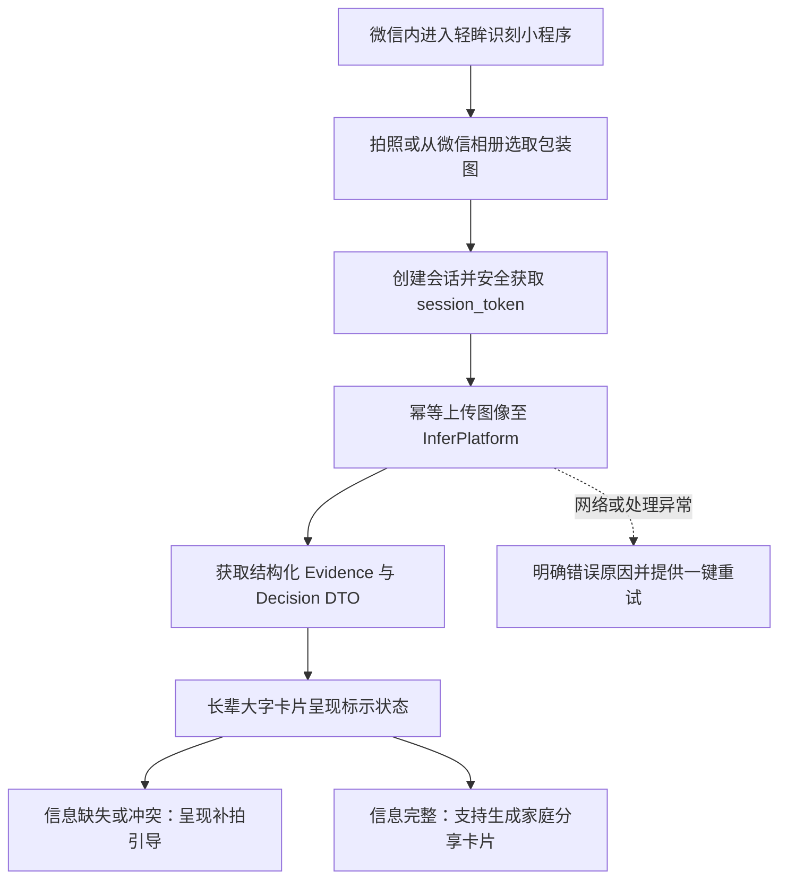

# WxClient · 轻眸识刻微信小程序端

> 前瞻性微信生态与关怀模式设计储备，面向免安装快速查验、长辈大字关怀与家庭分享
>
> **工程状态**：小程序产品与交互设计储备 · M0 优先验证 Web 核心链路 · 统一接入 InferPlatform 业务网关

WxClient 专注于轻眸识刻系统在微信生态内的轻量化查验与关怀模式探索。系统规划面向日常临时选购、长辈大字阅读及家庭健康互助场景，提供“即开即用、大字关怀、补拍引导与受控社交卡片”的轻量化交互体验；所有核心业务请求与推理能力统一接入 InferPlatform。

---

## 工程状态与边界说明

- **当前阶段**：系统处于架构规范与 M0 核心原型攻坚阶段，优先推进 Web 端核心闭环验证，本仓作为微信端设计储备同步演进；
- **实现范围**：M0 阶段聚焦微信端交互原型设计与适老化体验规范；社交卡片分享与订阅消息通知属于 C2 后续演进规划；
- **契约基准**：通信接口与数据传输模型严格受限于上位 [API.md](../ProjectPRD/contracts/API.md)、[DATA.md](../ProjectPRD/contracts/DATA.md) 与 [openapi.json](../ProjectPRD/contracts/openapi.json)。

---

## 一、核心定位与小程序特色

### 1. 核心负责内容

- **即开即用免安装通道**：依托微信生态优势，免去客户端安装成本，支持随手扫码或相册选图快速查验；
- **长辈大字关怀模式**：界面深度适配适老化标准，默认采用大号字号、高对比度色彩与大点击热区，提供清晰易读的保质期推导展示；
- **智能补拍交互引导**：当服务端返回信息缺失、反光模糊或日期冲突时，以简洁图文明确告知问题原因并引导二次针对性补拍；
- **家庭健康社交分享**：支持在用户明确授权下生成精炼的标示状态卡片，便于向家人或社区分享查验结论。

### 2. 系统协作与设计约束

- **算法与业务解耦**：小程序端不内置深度学习检测模型，所有图像分析与日期推导逻辑托管至 InferPlatform；
- **凭证安全隔离**：用户分享的卡片内容仅包含最小必要的标示结论与安全提示，严禁将内部会话凭证（`session_token`）写入分享参数或链接；
- **法定标示受限**：系统输出法定限定为“食品包装标示状态”，界面严禁给出食品绝对安全、无菌或可食用等卫生健康判断。

---

## 二、小程序交互主流程架构



---

## 三、适老化与长辈大字设计规范

1. **高对比度双态卡片**：在期、临期与超期状态不仅依赖色彩区分，同步配以明确的文字标签与高辨识度状态图标；状态文字保证在强光或弱视条件下的可辨识度。
2. **直观的白话引导**：避开生硬的算法术语，将服务端的“信息缺失”转化为“请对准包装上的日期数字再拍一张”，将“低置信度”转化为“文字有些模糊，请稳住手机重新拍摄”。
3. **极简操作路径**：查验主路径保持单屏直达，减少多级弹窗与次要功能对老年用户的认知干扰。

---

## 四、上位接口契约映射

小程序端在线交互完全复用 InferPlatform 提供的标准 API 契约：

| 功能模块 | 对应接口与方法 | 职责说明 |
| :--- | :--- | :--- |
| **会话初始化** | `POST /api/v1/sessions` | 创建小程序查验会话，获取受控临时凭据 |
| **图像上传** | `POST /api/v1/sessions/{session_id}/images` | 结合幂等键上传包装图片，触发服务端推理流水线 |
| **结果拉取** | `GET /api/v1/sessions/{session_id}` | 获取包含版本化 Observation、Evidence 与 Decision 的安全 DTO |
| **字段纠偏** | `POST /api/v1/sessions/{session_id}/correction` | 提交包装日期或保质期人工修正（C0 阶段） |

---

## 五、提议工程目录结构

以下为微信小程序仓库的建议目录布局，遵循现代小程序工程化架构：

```text
WxClient/                          # 微信小程序客户端仓库
├── README.md                      # 小程序定位与契约指引
├── project.config.json            # 小程序开发者工具工程配置
├── app.json                       # 全局路由与页面窗口配置
└── pages/                         # 小程序核心业务页面目录
    ├── index/                     # 拍摄查验与选图引导首页
    ├── result/                    # 大字结果与复核提示页面
    └── correction/                # 字段级人工纠偏交互页面
```

---

## 六、权威依据与参考文档

- **系统设计与规划**：[ProjectPRD/REQUIREMENTS.md](../ProjectPRD/REQUIREMENTS.md) · [ProjectPRD/ARCHITECTURE.md](../ProjectPRD/ARCHITECTURE.md) · [ProjectPRD/ROADMAP.md](../ProjectPRD/ROADMAP.md)
- **跨仓技术契约**：[contracts/API.md](../ProjectPRD/contracts/API.md) · [contracts/DATA.md](../ProjectPRD/contracts/DATA.md) · [contracts/openapi.json](../ProjectPRD/contracts/openapi.json)
- **规则与决策记录**：[contracts/DATE_RULES.md](../ProjectPRD/contracts/DATE_RULES.md) · [decisions/ADR-001-REPOSITORY_BOUNDARIES.md](../ProjectPRD/decisions/ADR-001-REPOSITORY_BOUNDARIES.md)
- **工程与质量规范**：[standards/ENGINEERING.md](../ProjectPRD/standards/ENGINEERING.md)
