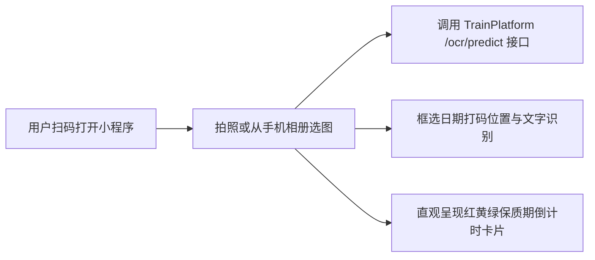

# WxClient · 轻眸识刻微信小程序端

> **组织归属**：`QingMouFoodDate` GitHub 组织  
> **仓库性质**：面向普通消费者的轻量免安装**食品包装拍照查生产日期与保质期推断工具**  

---

## 一、 核心定位与业务价值

微信小程序具备**“免安装、扫码即开、即用即走”**的天然用户体验优势，是轻眸识刻面向日常生活消费者与大创答辩现场评委掏出手机现场体验的最佳载体：



### 核心功能规划
1. **极简拍照查日期**：
   - 首页聚焦于中央大拍照按钮，对准食品包装开口、瓶盖、罐底即拍即查；
2. **保质期智能推断与倒计时卡片**：
   - 自动解析日期并计算剩余有效天数：
     - **安全 (NORMAL, 绿色)**：安全食用，剩余天数充足；
     - **临期预警 (NEAR EXPIRY, 黄色)**：临期食品，提醒尽早食用；
     - **已过期 (EXPIRED, 红色)**：已过期，明确警告并提醒处理；
3. **模糊打码轻量微调**：
   - 若个别字符因反光识别存疑，允许用户点击卡片一键修正，同时静默调用纠错接口回流。

---

## 二、 推荐架构参考

```text
WxClient/ (推荐目录结构参考)
├── README.md                      # 本说明文档
├── project.config.json            # 微信开发者工具项目配置
└── pages/                         # 小程序页面目录
    ├── index/                     # 首页：扫一扫、拍照、选图入口
    │   ├── index.wxml / index.vue
    │   └── index.ts
    └── result/                    # 识别结果与倒计时详情页
        ├── result.wxml / result.vue
        └── result.ts
```

---

## 三、 跨仓接口契约

本仓纯粹面向 C 端用户，通过标准 HTTPS 接口与后端通信：
- **在线预测接口**：严格遵循 [`ProjectPRD/contracts/api_specs.md`](https://github.com/QingMouFoodDate/ProjectPRD/blob/main/contracts/api_specs.md) 中的 `POST /api/v1/ocr/predict`；
- **错例反馈接口**：遵循 `POST /api/v1/samples/feedback`。

---

## 四、 技术选型指南 (留给负责人的自主空间)

- **推荐路线**：
  - **选项 A (官方轻量原生)**：`微信小程序原生 (WXML + WXSS + TypeScript)` —— 依赖少、体验流畅；
  - **选项 B (现代化框架)**：`UniApp (Vue 3)` 或 `Taro (React)` —— 开发体验现代、组件生态丰富。
- 小程序负责同学可自由根据擅长技能决断，重点保证**秒开性能、界面美观清爽与相机拍照清晰度**。

---

## 五、 阶段完成定义 (Definition of Done, DoD)

- [ ] **阶段 1 (静态界面与拍照)**：在微信开发者工具中跑通页面，能正常调起手机拍照并获取图片路径；
- [ ] **阶段 2 (对接接口出结果)**：调用后端 `/ocr/predict`，成功在结果页展示生产日期、到期日与红黄绿倒计时徽标。
