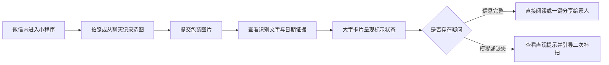

# WxClient · 轻眸识刻微信小程序端

> 面向微信生态的免安装查验通道与长辈友好型轻量入口规划
>
> **工程状态**：微信端暂缓实现 · Web M0 待实现

WxClient 面向微信生态，规划提供拍照、选图、大字结果呈现与受控分享交互，通过 HTTPS API 对接 InferPlatform 在线中枢。系统聚焦免安装查验、长辈大字关怀与家庭互助场景，不追求覆盖全部重型交互。

---

## 工程状态与阶段说明

WxClient 属于微信生态入口方向，当前暂缓实现，保留适老化产品架构、交互流程与微信专属能力规划，不作为 M0 最小闭环的前置依赖；恢复实施时单独评审范围和资源。

---

## 一、产品定位与客户端关系

WxClient 规划面向以下典型使用场景：

- **快速临时查验**：在微信内扫码或选图，免安装快速查看保质期；
- **长辈适老查验**：大字号、高对比度与语音辅助核对食品期限；
- **家庭结果分享**：查验后一键生成日期结果卡片，分享至家人群或微信好友。

协同分工如下：

| 客户端 | 定位 | 适合场景 |
| :--- | :--- | :--- |
| **MobileClient** | 移动端扩展方向 | 规划覆盖现场采集、手持防抖、弱网环境与本地离线台账 |
| **WebClient** | 通用 Web 基础客户端 | 桌面大屏基准入口，提供原图覆层与字段卡片双重视图呈现 |
| **WxClient** | 微信生态免安装入口 | 面向临时轻量查验、长辈大字关怀与家庭分享，降低使用门槛 |

它与 InferPlatform 在线中枢的职责分工如下：

| 能力 | WxClient 目标职责 | InferPlatform 目标职责 |
| :--- | :--- | :--- |
| 微信拍照与相册选取 | 小程序负责实现 | 不负责客户端硬件 |
| 长辈大字与适老交互 | 小程序端适配呈现 | 不负责前端渲染模式 |
| 会话创建与图片上传 | 携带幂等键发起调用 | 提供统一 API 网关 |
| 云端小目标检测与 OCR | 接收完整 Observation 呈现 | 调用内部 Inference Runtime |
| 日期语义推导与决策 | 接收 Evidence 与 Decision 展示 | 依据上位日期规则执行计算 |
| 字段级人工纠偏 | 提交表单修正并刷新界面 | 保存纠偏记录并即时重算决策 |
| 微信卡片安全分享 | 用户确认后触发分享 | 提供脱敏结构化数据 |
| 临期订阅提醒探索 | 发起用户订阅授权请求 | 规划后端提醒调度任务 |


系统输出限定为食品包装上的**标示状态**，不替代食品安全检测，不直接判断食品是否绝对可食用。

---

## 二、小程序交互主流程



M0 补拍新图需新建会话，C0 再支持向原会话追加图片；信息缺失不等于超期，技术失败单独提示。

---

## 三、功能分级与适老设计

### 1. 基础查验接入目标

- 依托微信扫码或相册选图快速建立会话，完成单图查验；
- 使用完整的 Observation、Evidence 与 Decision，展示食品生产日期、到期日与证据来源，分别呈现标示状态和复核状态；
- 支持字段级人工纠偏并即时刷新当前决策。

### 2. 长辈大字与交互关怀

- **大字号与高对比度**：关键日期文本与在期状态采用大字号，色彩符合无障碍对比度标准；
- **通俗白话引导**：将“未检出”或“低置信度”分别转化为“未找到日期，请补拍日期区域”或“识别不确定，请核对包装”；
- **大点击热区**：设置宽裕触控面积，降低误触率。

### 3. 微信生态专属探索

- **家庭卡片分享**：支持将日期查验结果生成聊天卡片，仅含必要的包装标示信息，不携带令牌或原始私图；
- **订阅消息探索**：在用户单独授权并确认标示日期后，探索通过微信服务通知提醒家庭临期食品。

订阅提醒尚待实现，接入时需核对模板与授权有效性；结果待处理或失败、信息缺失/冲突/低置信度、授权失效或模板不可用时，不创建期限提醒。

---

## 四、上位接口契约映射

小程序端在线交互完全复用 InferPlatform 提供的标准 API 契约：

| 接口端点与方法 | 功能职责说明 |
| :--- | :--- |
| `POST /api/v1/sessions` | 初始化小程序识别会话，获取短期不透明凭据 `session_token` |
| `POST /api/v1/sessions/{session_id}/images` | 结合 `Idempotency-Key` 幂等上传包装图片，触发服务端推理流水线 |
| `GET /api/v1/sessions/{session_id}` | 获取包含完整版本化 Observation、Evidence 与 Decision 的安全 DTO |
| `POST /api/v1/sessions/{session_id}/correction` | 提交生产日期、到期日、保质期或储存条件人工修正（C0 阶段） |

创建、上传和纠偏均使用 `Idempotency-Key`，同一请求重试复用原键和原内容，换图或改值使用新键。查询、上传和纠偏使用短期不透明 `session_token` 作为 Bearer 凭据，并校验会话与图片归属。GET 返回完整结果且不返回令牌，凭据遗失时需新建会话。

当前 `correction.v1` 仅定义 `mfg_date`、`exp_date`、`shelf_life`、`storage_condition`；OCR 原文/bbox 修正及图像变体展示尚未定义在线契约，需先评审。

---

## 五、提议工程目录结构

```text
WxClient/                          # 微信小程序客户端仓库
├── README.md                      # 小程序定位与契约指引
├── project.config.json            # 小程序开发者工具工程配置
├── app.json                       # 全局路由与页面窗口配置
└── pages/                         # 小程序核心业务页面目录
    ├── index/                     # 拍摄查验与选图引导首页
    ├── result/                    # 大字结果与复核提示页面
    └── correction/                # 字段级人工纠偏交互页面
```

---

## 六、相关文档

- [需求规格](https://github.com/QingMouFoodDate/ProjectPRD/blob/main/需求规格.md)
- [系统架构](https://github.com/QingMouFoodDate/ProjectPRD/blob/main/系统架构.md)
- [开发路线](https://github.com/QingMouFoodDate/ProjectPRD/blob/main/开发路线.md)
- [API 接口契约](https://github.com/QingMouFoodDate/ProjectPRD/blob/main/contracts/API.md)
- [数据模型](https://github.com/QingMouFoodDate/ProjectPRD/blob/main/contracts/DATA.md)
- [日期推导规则](https://github.com/QingMouFoodDate/ProjectPRD/blob/main/contracts/日期推导规则.md)
- [工程协作指南](https://github.com/QingMouFoodDate/ProjectPRD/blob/main/standards/工程协作指南.md)


