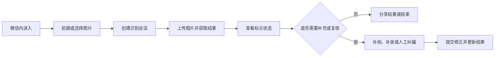

# WxClient · 轻眸识刻微信小程序端

> 面向普通消费者的微信生态免安装替代入口

WxClient 是系统面向微信生态的另一种使用入口，负责微信内的拍摄、选图、结果展示和分享交互，通过统一 HTTPS API 对接 `TrainPlatform`。它重点解决免安装、临时查验、长辈友好和结果分享问题，不以覆盖 MobileClient 或 WebClient 的全部能力为目标。

---

## 一、产品定位与客户端关系

主要场景：

- 消费者通过微信临时查看食品包装日期；
- 长辈用户使用大字和高对比度结果页面；
- 用户将识别结果分享给家人或其他微信联系人。

WxClient 与其他客户端的关系如下：

| 客户端 | 定位 | 适合场景 |
| :--- | :--- | :--- |
| **MobileClient** | 功能完整的移动端主客户端 | 高频使用、现场采集、弱网环境和本地记录 |
| **WebClient** | 通用 Web 基础客户端 | 跨设备在线识别、证据查看和人工纠偏 |
| **WxClient** | 微信生态免安装替代入口 | 临时查验、长辈使用和结果分享 |

WxClient 是针对不同使用门槛和使用场景的替代选择。复杂证据查看、长期记录、弱网队列或端侧能力可引导用户转至 WebClient 或 MobileClient。

| 能力 | WxClient | TrainPlatform |
| :--- | :--- | :--- |
| 相机、相册和拍摄入口 | 负责 | 不负责 |
| 识别会话和图片上传 | 调用接口 | 提供接口 |
| 检测、OCR 和日期推导 | 展示结果 | 负责执行 |
| 人工纠偏 | 发起提交 | 保存并重新决策 |
| 分享卡片 | 负责触发 | 提供结构化结果 |
| 订阅提醒 | 请求授权 | 管理提醒任务 |

系统输出的是食品包装上的**标示状态**，不替代食品安全检测，也不直接判断食品是否绝对安全或适宜食用。

---

## 二、用户流程



---

## 三、功能分级与适用边界

### 1. C0 核心闭环

- 使用相机或相册选择图片；
- 创建会话并上传一张或多张图片；
- 展示生产日期、保质期、标示状态和复核提示；
- 提交人工纠偏；
- 在联网条件下完成云端识别。

### 2. C1 交互增强

- 大字、高对比度和文字图标结合的结果卡片；
- 同一食品的多图会话；
- 缺失字段补拍引导；
- 识别结果分享卡片。

### 3. C2/C3 微信生态探索

- 结果语音播报；
- 经用户授权的订阅消息提醒；
- 条码辅助解析；
- 微信生态内的个人记录。

以上能力受微信版本、设备、用户权限和平台审核规则限制，不应阻断图片上传和结果查看主流程。

WxClient 的重点是低门槛接入和轻量交互，不要求与 MobileClient 在本地台账、长期后台任务、复杂证据查看或端侧推理方面保持等价；复杂任务可转至 WebClient 或 MobileClient 继续处理。

---

## 四、结果呈现

- 首页提供拍摄和选图入口；
- 结果页展示日期文本、生产日期、到期日、保质期和标示状态；
- 使用文字、图标和颜色共同表达“标示在期内、标示临期、标示已超期、暂无法判定”；
- 信息缺失、证据冲突或低置信度时，提示补拍或人工核对；
- 分享内容只展示必要的识别结果，不包含不必要的用户信息。

剩余天数只能依据服务端返回且已确认的标示日期计算。标示状态不构成食品安全结论。

---

## 五、微信平台能力与限制

- 用户授权并且设备支持时，使用小程序相机能力；权限被拒绝时提供相册选图；
- 语音播报能力取决于微信运行环境和可用语音服务；
- 订阅消息需经用户主动授权，并符合微信模板、频率和发送规则；
- 订阅失效、用户拒绝授权或服务端不可用时，不保证提醒送达；
- 信息缺失、证据冲突或低置信度时，不创建确定性的期限提醒；
- 网络中断时提供重试，不显示伪造的成功结果。

---

## 六、跨仓接口契约

本仓通过 HTTPS 接入 `TrainPlatform`：

- 创建会话：`POST /api/v1/sessions`
- 上传图片并执行增量识别：`POST /api/v1/sessions/{session_id}/images`
- 获取会话结果：`GET /api/v1/sessions/{session_id}`
- 提交人工纠偏：`POST /api/v1/sessions/{session_id}/correction`

接口字段、响应结构、错误码和状态枚举以 [`ProjectPRD/contracts/API.md`](https://github.com/QingMouFoodDate/ProjectPRD/blob/main/contracts/API.md) 为准。小程序不在客户端重复实现日期推导规则。

---

## 七、工程结构

```text
WxClient/
├── README.md                      # 小程序说明与开发约定
├── project.config.json            # 微信开发者工具配置
├── app.json                       # 全局页面和窗口配置
├── app.ts                         # 应用生命周期入口
├── pages/
│   ├── index/                     # 拍摄和选图入口
│   ├── result/                    # 结果卡片和补拍引导
│   └── correction/                # 人工纠偏
├── components/                    # 状态卡片、大字模式和分享组件
├── services/                      # API、上传和订阅服务
├── stores/                        # 会话状态管理
├── types/                         # TypeScript 类型定义
└── utils/                         # 格式化和平台工具
```

采用 Taro 或 Uni-app 时，目录结构按对应框架调整。

---

## 八、技术选型

### 路线 A：微信小程序原生

`WXML + WXSS + TypeScript`

- *优势*：依赖少、包体积可控，便于直接调用微信相机、分享和订阅消息等能力；
- *适用场景*：项目主要面向微信生态，优先保证平台能力和运行稳定性。

### 路线 B：跨端框架

`Taro + React` 或 `Uni-app + Vue 3`

- *优势*：便于复用部分 Web 类型、组件和业务逻辑；
- *适用场景*：后续需要扩展到其他小程序或移动端，且团队已有 React/Vue 跨端开发经验。

---

## 九、权限、隐私与安全

- 按需申请相机、相册和订阅消息权限；
- 未授权时提供选图、关闭播报或跳过提醒等替代路径；
- 图片上传前提示用途和大小限制；
- 不在客户端日志中保存原始图片和完整识别文本；
- 网络失败、授权失败或订阅失败时不显示成功状态；
- 分享卡片不暴露不必要的个人信息。

---

## 十、相关文档

- [系统需求](https://github.com/QingMouFoodDate/ProjectPRD/blob/main/REQUIREMENTS.md)
- [系统架构](https://github.com/QingMouFoodDate/ProjectPRD/blob/main/ARCHITECTURE.md)
- [API 接口契约](https://github.com/QingMouFoodDate/ProjectPRD/blob/main/contracts/API.md)
- [数据模型](https://github.com/QingMouFoodDate/ProjectPRD/blob/main/contracts/DATA.md)
