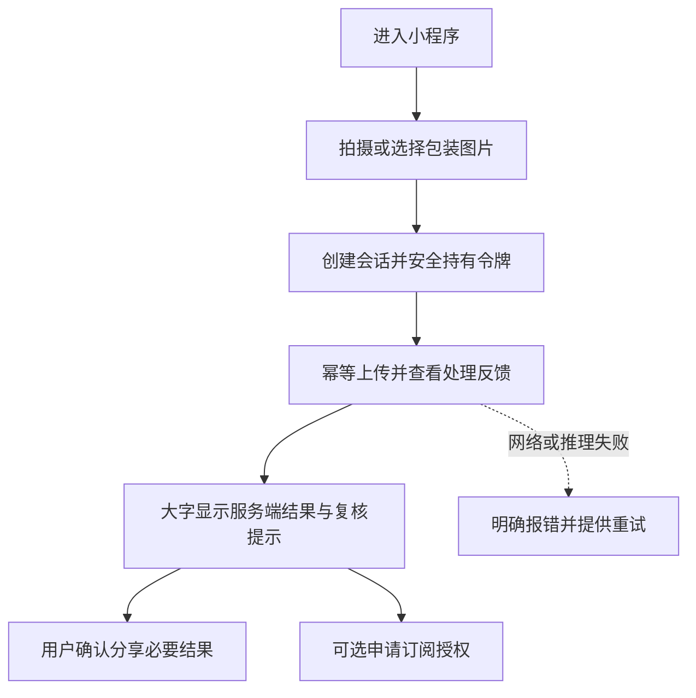

# WxClient · 轻眸识刻微信小程序端

> 后续微信生态入口规划，工程暂缓；不是 M0 前置依赖，也不是已运行小程序。

WxClient 规划面向微信内临时查验、长辈大字阅读与家庭分享，负责拍摄/选图和结果交互，所有业务 API 接入 `InferPlatform`。平台编排会话、调用内部 Inference Runtime 并聚合 Evidence、生成 Decision，客户端不直接访问 TrainPlatform、数据库或模型文件。

当前产品设计不能证明小程序代码、构建、真机测试、部署或模型已经交付。Web 优先验证的 M0 单图闭环也待实现；多图、完整展示和纠偏属 C0 后续，不承诺所有客户端已运行。

## 一、范围与需求映射

- **FR-C2-002（后续候选、工程暂缓）**：大字/高对比度模式、社交卡片分享、用户主动授权的订阅消息探索。
- **C0 后续接入**：复用 FR-C0-005 的会话与结果交互、FR-C0-006 的契约内纠偏，消费 FR-C0-002 至 004 输出；多图追加引用 C0，不重分类为 C2。FR-C0-001 是训练与评测数据准入，不是普通选图上传职责。
- **FR-C1-001 候选**：条码辅助，只作弱辅助证据，不覆盖包装文字，不作为图片识别前置条件。
- **其他可选规划**：补拍引导、语音播报和微信内个人记录，需验证平台能力、权限和隐私要求后再决定。

项目保持 **8 仓：7 个项目仓 + `.github` 组织配置仓**；Inference Runtime 是 InferPlatform 内部逻辑模块，不是第 9 仓。WxClient 不要求覆盖其他客户端的全部能力；Web 本身也是浏览器访问入口，不能将免安装写成 Web 的非目标。跨端授权、接续处理和同步契约尚未实现，只能规划入口引导，不承诺到其他端无缝继续会话。

输出仅是食品包装**标示状态**，不是食品安全检测，不保证可食用；响应速度与识别效果需实际评测，不作性能宣传。

## 二、规划路径与微信特有模块



此图是后续交互目标；订阅授权不代表已有服务端提醒任务，也不保证提醒已创建或送达。

### 大字结果与补拍引导

- 结果卡片优先显示标示状态、服务端日期和复核原因，结合文字、图标与颜色，支持大字、高对比度和足够点击区域。
- 缺失、冲突或低置信度时给出补拍/人工核对建议；多图追加及契约内补录须在 C0 对应能力实现后接入，不作为 M0 前置。
- 语音播报为可选能力，受微信版本、设备和可用服务约束；不可用时保留文字结果，不阻断查验。

### 分享卡片

- 用户主动确认后分享最少必要的标示结果、复核提示和非食品安全说明；不含原始图片、完整 OCR 等不必要信息。
- 不分享 `session_token`，不将令牌放在卡片、二维码、URL 或日志中；`session_id` 不作为访问授权，持有分享内容不自动获得原会话权限。
- 分享交互仅为规划；带授权的分享链接、接续会话或跨端任务需要未来独立契约，不能借现有会话 API 宣称支持。

### 授权订阅

需用户主动授权，并遵守微信模板、频率、有效期和审核规则。**服务端订阅任务契约尚未实现**，授权通过不能显示“提醒已创建”。用户拒绝/撤销、订阅失效或服务端不可用时明确提示，不保证送达；证据缺失、冲突或低置信度时不创建确定性期限提醒，不在客户端重算日期规则或业务状态。

## 三、完整结果与纠偏边界

InferPlatform 按契约返回完整、版本化 Observation、Evidence、Decision **安全 DTO**。小程序可以简化显示层，但不能假定平台已有轻量摘要字段/端点；服务端摘要需未来单独契约。机器 Observation 来自 Runtime，客户端不提交或改写；Evidence 与 Decision 由平台生成，客户端不计算到期日、临期阈值或通过剩余天数重算业务结果。

- 标示状态统一为：在期 `WITHIN_MARKED_PERIOD`、临期 `NEAR_EXPIRY`、超期 `PAST_MARKED_PERIOD`、无法判定 `UNDETERMINED`。
- 复核状态统一为：证据完备 `EVIDENCE_COMPLETE`、信息缺失 `INFORMATION_MISSING`、证据冲突 `EVIDENCE_CONFLICT`、低置信度 `LOW_CONFIDENCE`。
- 两种状态独立呈现；**推理失败不是 `UNDETERMINED`**，请求失败不伪造成功结果。保存条件与开封说明只作条件提示。
- 原始裁剪、校正、增强和 OCR 输入图等 `variants` 保留为后续可选视图，不假定当前 API 已有对应字段或资产地址。

C0 纠偏待实现：当前 `correction.v1` 仅定义 `mfg_date`、`exp_date`、`shelf_life`（`value` + `unit`，单位 `DAY` / `MONTH` / `YEAR`）和 `storage_condition`。原始 OCR 文本与检测框修正仍属规划，尚未在 v1 定义，不宣称接口支持。合法纠偏接受后立即更新当前 Decision，失败时保留输入但不显示已保存；训练候选另需 TrainPlatform 质量审核，不是自动训练标签，也不直接修改线上模型。

## 四、InferPlatform 接口与 UX 状态

以下均为后续契约接入目标，不代表接口或小程序已上线：

| 阶段 | 方法与路径 | 用途 |
| :--- | :--- | :--- |
| 后续在线接入 | `POST /api/v1/sessions` | 创建会话，返回 `session_id` 与 `session_token` |
| 后续在线接入 | `POST /api/v1/sessions/{session_id}/images` | 上传图片，由平台处理并更新结果 |
| 后续在线接入 | `GET /api/v1/sessions/{session_id}` | 获取完整版本化安全 DTO |
| C0 后续接入 | `POST /api/v1/sessions/{session_id}/correction` | 提交契约内纠偏 |

创建后的会话请求使用 `Authorization: Bearer <session_token>`；写操作携带 `Idempotency-Key`，同一操作重试复用原键及请求，新操作使用新键。使用 HTTPS，安全持有并及时清理令牌，不分享、不日志、不 URL。上传域名与微信网络配置需按实际环境验证，不伪造已配置状态。

提议 UX 状态（不新增服务端枚举）：

```text
IDLE -> CREATING_SESSION -> UPLOADING -> PROCESSING -> RESULT_READY
请求失败 -> FAILED（显示原因与重试入口）
分享/订阅：AWAITING_USER_CONFIRMATION -> SUCCEEDED / DECLINED / FAILED
```

分享/订阅成功须以各自实际能力的成功回调或业务确认判断，不以点击、授权或上传成功替代。上传/推理以 HTTP 与业务响应共同确认；网络中断或超时保留待确认操作并按契约幂等重试/查询，不猜测成功。复核状态是业务提示，不等同于传输失败。不承诺小程序后台持久队列或跨端恢复能力。

## 五、设备权限、隐私与错误要求

- 按需申请相机、相册和订阅权限；相机拒绝时提供仍需相应授权的相册选择路径，授权均不可用时说明如何重新授权，不显示已上传。
- 微信版本、设备、平台审核及前后台生命周期限制可能影响相机、分享、播报或订阅；不可用时降级为文字结果与主流程重试。
- 上传前说明用途和契约大小/格式限制；本地缓存可清理，不保存不必要的图片、结果或个人信息。
- 日志不记录原始图片、完整 OCR、令牌等敏感内容；分享不泄露会话访问凭证。
- 图片格式/大小/质量错误、会话/令牌失效、网络失败、推理超时、分享失败和订阅失败分别提示，不将失败包装为 success。

## 六、提议工程结构与技术候选

以下目录逐行注释，仅为建议，不代表工程已经存在：

```text
WxClient/                          # 微信入口规划仓库
├── README.md                      # 阶段、UX 与契约入口
├── project.config.json            # 候选微信开发者工具配置
├── app.json                       # 页面与窗口配置
├── app.ts                         # 应用生命周期入口
├── pages/                         # 页面模块
│   ├── index/                     # 拍摄、选图与权限说明
│   ├── result/                    # 大字结果、证据提示与补拍引导
│   └── correction/                # C0 契约内补录和纠偏
├── components/                    # 状态卡片、大字模式与分享组件
├── services/                      # API 鉴权、幂等上传与后续订阅适配
├── stores/                        # 会话 UX 状态与受控令牌生命周期
├── types/                         # 契约版本与安全 DTO 类型
└── utils/                         # 展示格式化与微信能力检测，不算日期规则
```

候选为原生 WXML/WXSS/TypeScript 或 Taro/Uni-app；按相机、分享、订阅兼容性与维护成本评估，框架未定，目录可随选型调整。

## 七、事实源与相关文档

统一以 [ProjectPRD README](https://github.com/QingMouFoodDate/ProjectPRD/blob/main/README.md)、[REQUIREMENTS](https://github.com/QingMouFoodDate/ProjectPRD/blob/main/REQUIREMENTS.md)、[ARCHITECTURE](https://github.com/QingMouFoodDate/ProjectPRD/blob/main/ARCHITECTURE.md) 为产品与职责依据；以 [API](https://github.com/QingMouFoodDate/ProjectPRD/blob/main/contracts/API.md)、[DATA](https://github.com/QingMouFoodDate/ProjectPRD/blob/main/contracts/DATA.md)、[DATE_RULES](https://github.com/QingMouFoodDate/ProjectPRD/blob/main/contracts/DATE_RULES.md)、[MODEL](https://github.com/QingMouFoodDate/ProjectPRD/blob/main/contracts/MODEL.md)、[TRAINING](https://github.com/QingMouFoodDate/ProjectPRD/blob/main/contracts/TRAINING.md) 为契约依据；仓库边界见 [ADR-001](https://github.com/QingMouFoodDate/ProjectPRD/blob/main/decisions/ADR-001-REPOSITORY_BOUNDARIES.md)。

DATE_RULES、TRAINING、ADR-001、OpenAPI 与四份 JSON Schema 已纳入 ProjectPRD，均仍为候选或设计依据；本仓只引用，不重复定义。当前 GitHub 仓库为 private，链接需要相应访问权限，不保证所有访客可访问；所有规划与接口定义均不等同于已实现。
