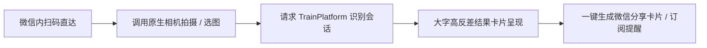

# WxClient · 轻眸识刻微信小程序端

> **组织归属**：`QingMouFoodDate` GitHub 组织  
> **仓库性质**：面向普通消费者的免安装轻量查验工具与社交分享载体

---

## 一、 核心定位与业务价值

微信小程序定位为**“多一个选择，但不一定是更好的选择”**。其实现优先级排在 WebClient 与 MobileClient 之后。受限于微信运行沙箱与后台机制，本仓不承担重度端侧计算与系统级后台常驻任务，核心聚焦于**免安装、即用即走、社交转发与轻量查验**的备选场景：



---

## 二、 功能要求与呈现形态

### 1. 轻量化查验功能
- **原生相机流接入**：使用小程序原生 `camera` 组件，支持轻触屏幕对焦与即时拍摄；
- **基础日期提取与状态呈现**：调用业务接口提取包装上的打码日期与保质期，通过红黄绿卡片直观呈现“标示在期内/临期/已超期”状态及距离截止日的剩余天数。

### 2. 微信生态特色能力
- **长辈关怀大字模式**：针对长辈看微小喷码吃力的痛点，提供高反差色彩卡片、超大字号展示，并支持结果语音播报；
- **微信社交一键分享**：识别结果一键生成标准格式的“食品日期卡片”，支持转发至微信好友或家庭微信群；
- **单次订阅消息提醒**：经用户主动授权后，在食品临近标示到期日前通过“微信服务通知”发送提醒。

### 3. 呈现形态
- **简洁直观的卡片式前台**：
  - 首页：顶部中央为拍摄与选图入口，下方展示查验小贴士；
  - 结果页：半屏抽屉或卡片浮层，醒目标注日期与是否过期，并提供缺项补充入口。

---

## 三、 推荐架构参考

```text
WxClient/
├── README.md                      # 小程序端说明文档与微信生态开发指引
├── project.config.json            # 微信开发者工具工程构建配置
├── app.json                       # 小程序全局页面路由与窗口外观配置
├── app.ts                         # 小程序全局生命周期入口与应用初始化
└── pages/                         # 小程序页面与交互视图目录
    ├── index/                     # 首页轻量拍摄入口与选图相册流转
    ├── result/                    # 识别结果卡片展示与缺项补充抽屉
    └── components/                # 大字关怀组件、状态浮层与分享卡片
```

---

## 四、 跨仓接口契约

本仓纯粹面向用户前台交互，通过 HTTPS 接入业务后端：
- **会话与图片预测**：遵循统一接口规约对接 `POST /api/v1/sessions` 及图片上传接口；
- **错例反馈**：对接 `POST /api/v1/sessions/{id}/correction` 提交用户校正数据。

---

## 五、 技术选型参考

- **路线 A（推荐 · 极简原生）**：`微信小程序原生 (WXML + WXSS + TypeScript)`
  - *优势*：零第三方框架编译开销，运行依赖少，包体积小，调用微信原生 API 稳定且无兼容阻碍。
- **路线 B（备选 · 跨端组件复用）**：`Uni-app (Vue 3) / Taro (React)`
  - *优势*：便于与 Web 前端共享部分类型定义与逻辑代码。
