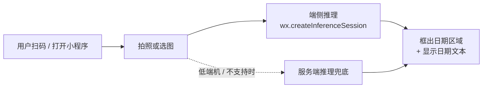

# QingMouMiniProgram · 轻眸识刻微信小程序

> 轻眸识刻的 **C 端形态**：对着食品包装拍一张，直接看到生产日期。

本仓是 [轻眸识刻](https://github.com/QingMouFoodDate/QingMouPRD) 面向**终端消费者**的微信小程序。

> ⚠️ **状态：未来形态，暂不排期。** 当前优先把模型训练出来（平台在
> [QingMouInfer](https://github.com/QingMouFoodDate/QingMouInfer)，训练代码在
> [QingMouTrain](https://github.com/QingMouFoodDate/QingMouTrain)）。
> 本仓先记录技术结论与约束，避免将来返工。

---

## 一、目标形态



**一句话**：拍一张 → 端上跑模型 → 显示「生产日期 2026-10-01」。

---

## 二、为什么走端侧（而不是服务端为主）

这是经过实测调研后的结论，不是假设：

| 事实 | 影响 |
| :--- | :--- |
| `wx.createInferenceSession` 是官方能力（**基础库 2.30.0+**），只接受 `.onnx` | 端侧推理可行，**无需** WASM |
| 服务端路线的硬约束：域名需 **https + ICP 备案**、**并发上限 10**、默认超时 60s、**进后台 5s 即中断** | C 端量级下服务端路线有硬天花板，只能作兜底 |
| 端侧推理**不消耗服务端资源** | C 端规模化时成本可控 |

**结论**：**端侧为主，服务端兜底。**

---

## 三、硬约束（必须遵守，否则做不出来）

| # | 约束 | 数值 / 说明 |
| :--- | :--- | :--- |
| 1 | 基础库版本 | **≥ 2.30.0**（低于此版本无端侧推理能力 → 走兜底） |
| 2 | 模型格式 | **仅 `.onnx`** |
| 3 | 模型分发 | `.onnx` **不在可上传文件白名单内** → 必须 `wx.downloadFile` 到本地后加载 |
| 4 | 单文件下载上限 | 200 MB |
| 5 | 包体积 | 单包/主包 **≤ 2 MB**，所有分包总计 **≤ 30 MB** |
| 6 | 本地文件系统 | 用户/缓存文件合计 **≤ 200 MB**（模型 + 缓存共用，需配额管理） |
| 7 | WASM 路线 | ❌ **排除**：`WXWebAssembly.instantiate` 只接受代码包内路径，无法加载网络下载的 wasm；且 onnxruntime-web 最小 wasm 产物 12.8 MB，远超单包 2 MB |
| 8 | 算子覆盖 | CPU 上有 Conv2D / Pooling2D / Resize2D / Concat / **NMS** / Softmax 等；**GPU 未对外开放** |
| 9 | 性能注意 | iOS 逻辑层为 JavaScriptCore，**无法开启 JIT** → 前/后处理避免在 JS 里做大循环 |
| 10 | 端侧推理参数 | `precisionLevel`(0–4)、`allowQuantize`、`allowNPU`(iOS)、`typicalShape` |

---

## 四、技术栈

| 层 | 选型 |
| :--- | :--- |
| 平台 | **微信小程序原生 + TypeScript** |
| 端侧推理 | `wx.createInferenceSession`（官方 API，ONNX，CPU / iOS NPU） |
| 相机 | `camera` 组件（`takePhoto` 拍照；`onCameraFrame` 取 RGBA 实时帧） |
| 模型下发 | `wx.downloadFile` → 本地用户目录 → 校验 sha256 → 加载 |
| 兜底 | 调 `QingMouInfer` 的推理接口（`wx.uploadFile` / `wx.request`） |

**模型档位参考**（YOLOX，Apache-2.0）：Nano `0.91M 参数 / 1.08 GFLOPs @416`；
Tiny `5.06M / 6.45 GFLOPs`。具体档位以实测的体积/耗时/精度三角为准。

---

## 五、待实测确认（开工前必须先做）

以下为**数值**，不是可行性问题：

- [ ] ONNX 模型体积与下载耗时
- [ ] 首帧加载耗时、单帧推理耗时
- [ ] 内存峰值
- [ ] int8 量化的精度损失
- [ ] 机型覆盖率（哪些机型不支持或过慢）
- [ ] 端云一致性（端侧与平台侧同图同参数的结果差异）

---

## 六、规划目录结构

```text
QingMouMiniProgram/
├── miniprogram/
│   ├── pages/
│   │   ├── scan/            # 拍照 / 选图
│   │   ├── result/          # 结果展示（框 + 日期文本）
│   │   └── history/         # 历史记录
│   ├── services/
│   │   ├── inference/       # createInferenceSession 封装与降级
│   │   ├── modelManager/    # 下载 / 校验 / 缓存 / 版本比对
│   │   └── api/             # 平台接口（含服务端兜底）
│   └── utils/               # 前处理（RGBA→NCHW、resize、归一化）、后处理（解码 + NMS）
├── project.config.json
└── README.md
```

---

## 七、与平台的契约

| 契约 | 权威定义 | 本仓职责 |
| :--- | :--- | :--- |
| 模型清单与下载 | `QingMouInfer` 提供清单 + 预签名 URL | 下载、sha256 校验、按 `(model_version_id, target_platform)` 缓存 |
| 推理接口（兜底） | `QingMouInfer` 开放 API | 按契约调用 |
| 模型格式 | `QingMouTrain` 导出 **ONNX** | 直接加载 `.onnx`，无需额外转换 |

**注意**：一期平台只做**目标检测**，输出的是框，不是日期字符串。
若要在 C 端直接显示日期文本，需要 **OCR 能力**（属 Stage-2），
在此之前端上只能展示"框出的区域"，由用户肉眼读取。

---

## 八、相关文档

| 文档 | 内容 |
| :--- | :--- |
| [PLAN.md](https://github.com/QingMouFoodDate/QingMouPRD/blob/main/PLAN.md) | 产品形态 + Issue 清单 |
| [REPOS.md](https://github.com/QingMouFoodDate/QingMouPRD/blob/main/REPOS.md) | 仓库地图与跨仓契约 |
| [P0120](https://github.com/QingMouFoodDate/QingMouPRD/blob/main/PRD/08_端接入/P0120_小程序接入契约.md) | 小程序接入契约（21 个端点、端侧能力硬约束表） |

---

## License

内部项目，未经许可不得外传。
