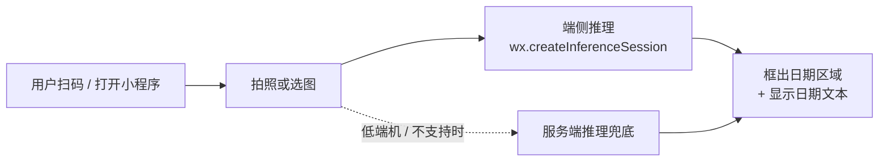

# QingMouMiniProgram · 轻眸识刻微信小程序

> 在超市拿起一盒牛奶，拍一张，看到它是什么时候生产的。

本仓是 [轻眸识刻](https://github.com/QingMouFoodDate/QingMouPRD) 面向**普通消费者**的微信小程序。

> ⚠️ **状态：未来形态，暂不排期。**
> 当前的全部精力在把模型训出来（平台在 [QingMouInfer](https://github.com/QingMouFoodDate/QingMouInfer)，
> 训练代码在 [QingMouTrain](https://github.com/QingMouFoodDate/QingMouTrain)）。
> 本仓先记录已经查证过的技术结论与硬约束，避免将来开工时踩一遍已知的坑。

---

## 我们想做成什么样

现在买东西想看一眼生产日期，做法是把包装翻来覆去找那行小字。字体可能是点阵喷码，可能被反光挡住，可能印在弧面上——找到了还得眯着眼辨认。

我们希望这件事变成：**掏出手机，拍一张，日期直接显示出来。**

选微信小程序而不是做个 App，理由很直接：**没有人会为了看一眼生产日期去装一个 App**。小程序不用安装、扫码即用、拍完就走，这是这类"偶发、轻量、即用即走"的场景唯一合理的形态。



---

## 一个关键的架构结论：端侧为主

一开始的直觉是"用户拍完照片传给服务器，服务器算完返回结果"——这是最常见、也最容易想到的做法。

但把微信的约束查清楚之后，这个方案站不住：

| 约束 | 实际数值 | 意味着什么 |
| :--- | :--- | :--- |
| 请求域名要求 | 必须 **https + ICP 备案** | 个人开发者根本申请不下来 |
| **并发上限** | **10** | 只要有 11 个人同时用，第 11 个就被拒——这在 C 端是不可接受的 |
| 默认超时 | 60 秒 | 慢网络下容易失败 |
| 进入后台 | **5 秒即中断** | 用户拍完切出去看一下微信消息，请求就断了 |

也就是说，服务端路线在**一个人测着玩**的时候没问题，**一旦真的有人用**就会撞死。

好消息是微信提供了官方的端侧推理能力：**`wx.createInferenceSession`**（基础库 2.30.0 起）。模型直接跑在用户手机上，不消耗服务器、没有并发上限、断网也能用、照片不出手机（对隐私也是好事）。

所以结论是：**端侧推理为主，服务端只作兜底**（低端机、模型超规格、端侧不支持时才降级）。

这不是架构偏好，是被上面的并发上限逼出来的唯一可行解。

---

## 硬约束清单

这些都是查证过的、绕不过去的限制。**没有这些前提，功能做不出来。**

| # | 约束 | 数值 / 说明 |
| :--- | :--- | :--- |
| 1 | 基础库版本 | **≥ 2.30.0**（低于此版本无端侧推理能力 → 走兜底） |
| 2 | 模型格式 | **仅 `.onnx`**（官方接口只接受这一种） |
| 3 | 模型分发 | `.onnx` **不在可上传文件白名单内** → 不能打进代码包，必须 `wx.downloadFile` 下载到本地再加载 |
| 4 | 单文件下载上限 | 200 MB |
| 5 | 包体积 | 单包/主包 **≤ 2 MB**，所有分包总计 **≤ 30 MB** |
| 6 | 本地文件系统 | 用户/缓存文件合计 **≤ 200 MB** —— 模型与缓存共用，必须做配额管理 |
| 7 | **WASM 路线已排除** | `WXWebAssembly.instantiate` 只接受代码包内路径，**无法加载网络下载的 wasm**；且 onnxruntime-web 最小 wasm 产物 12.8 MB，远超单包 2 MB |
| 8 | 算子覆盖 | CPU 上有 Conv2D / Pooling2D / Resize2D / Concat / **NMS** / Softmax 等；**GPU 未对外开放** |
| 9 | 性能注意 | iOS 逻辑层是 JavaScriptCore，**无法开启 JIT** → 前/后处理避免在 JS 里做大循环 |
| 10 | 端侧推理参数 | `precisionLevel`(0–4)、`allowQuantize`、`allowNPU`(iOS)、`typicalShape` |

第 7 条值得单独说：很多人第一反应是"用 WASM 跑 onnxruntime-web"，但在小程序里这条路是堵死的。**不用在这上面浪费时间。**

---

## 技术栈

| 层 | 选型 | 说明 |
| :--- | :--- | :--- |
| 平台 | **微信小程序原生 + TypeScript** | 端侧推理能力用原生 API 最稳 |
| 端侧推理 | `wx.createInferenceSession` | 官方 API，ONNX，CPU / iOS NPU |
| 相机 | `camera` 组件 | `takePhoto` 拍照；`onCameraFrame` 取 RGBA 实时帧 |
| 模型下发 | `wx.downloadFile` | 下载到本地用户目录 → 校验 sha256 → 加载 |
| 兜底 | [QingMouInfer](https://github.com/QingMouFoodDate/QingMouInfer) 的推理接口 | 端侧不可用时降级 |

**模型档位参考**（YOLOX，Apache-2.0）：

| 档位 | 参数量 | 计算量 | 备注 |
| :--- | :--- | :--- | :--- |
| YOLOX-Nano | 0.91 M | 1.08 GFLOPs @416 | 体积与速度优先 |
| YOLOX-Tiny | 5.06 M | 6.45 GFLOPs | 精度优先 |

具体选哪档，以实测的「体积 / 耗时 / 精度」三角为准——这三个指标在手机上互相拉扯，必须实测。

---

## 开工前必须先做的实测

下面这些都是**数值问题，不是可行性问题**（可行性已经确认）。开工第一件事是拿真机跑一遍：

- [ ] ONNX 模型体积与下载耗时
- [ ] 首帧加载耗时、单帧推理耗时
- [ ] 内存峰值
- [ ] int8 量化的精度损失
- [ ] 机型覆盖率（哪些机型不支持或过慢）
- [ ] 端云一致性（端侧与平台侧同图同参数的结果差异）

---

## 一个必须提前说清楚的限制

**一期平台只做目标检测，输出的是「框」，不是「日期字符串」。**

也就是说，小程序能把日期所在的区域框出来，但**读不出 `2026-10-01` 这几个字**——那需要 OCR 能力，属于第二阶段。

在此之前，C 端能提供的是"告诉你日期在哪"，用户自己看一眼读出来。这依然比在弧面上找一行小字强得多，但**不是完整的产品形态**，这一点要先想清楚，免得期望错位。

---

## 规划目录结构

```text
QingMouMiniProgram/
├── miniprogram/
│   ├── pages/
│   │   ├── scan/            # 拍照 / 选图
│   │   ├── result/          # 结果展示（框 + 日期文本）
│   │   └── history/         # 历史记录
│   ├── services/
│   │   ├── inference/       # createInferenceSession 封装与降级
│   │   ├── modelManager/    # 下载 / 校验 / 缓存 / 版本比对
│   │   └── api/             # 平台接口（含服务端兜底）
│   └── utils/               # 前处理（RGBA→NCHW、resize、归一化）、后处理（解码 + NMS）
├── project.config.json
└── README.md
```

---

## 与平台的契约

| 契约 | 权威定义 | 本仓职责 |
| :--- | :--- | :--- |
| 模型清单与下载 | [QingMouInfer](https://github.com/QingMouFoodDate/QingMouInfer) 提供清单 + 预签名 URL | 下载、sha256 校验、按 `(model_version_id, target_platform)` 缓存 |
| 推理接口（兜底） | [QingMouInfer](https://github.com/QingMouFoodDate/QingMouInfer) 开放 API | 按契约调用 |
| 模型格式 | [QingMouTrain](https://github.com/QingMouFoodDate/QingMouTrain) 导出 **ONNX** | 直接加载 `.onnx`，无需额外转换 |

**与 RN 客户端共用同一条 ONNX 导出链路** —— 这意味着 [QingMouTrain](https://github.com/QingMouFoodDate/QingMouTrain) 只需要维护一种端侧格式。

---

## 相关文档

仓库里只放代码，产品设计与全部决策依据在 [QingMouPRD](https://github.com/QingMouFoodDate/QingMouPRD)：

| 文档 | 内容 |
| :--- | :--- |
| [PLAN.md](https://github.com/QingMouFoodDate/QingMouPRD/blob/main/PLAN.md) | 产品形态 + Issue 清单 |
| [REPOS.md](https://github.com/QingMouFoodDate/QingMouPRD/blob/main/REPOS.md) | 仓库地图与跨仓契约 |
| [P0120](https://github.com/QingMouFoodDate/QingMouPRD/blob/main/PRD/08_端接入/P0120_小程序接入契约.md) | 小程序接入契约（21 个端点、端侧能力硬约束表） |

---

## License

内部项目，未经许可不得外传。
