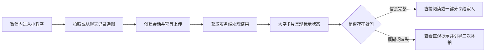

# WxClient · 轻眸识刻微信小程序端

> 面向微信生态的免安装查验通道与长辈友好型轻量入口规划
>
> **工程状态**：小程序产品与交互设计储备 · M0 优先验证 Web 核心链路 · 统一接入 InferPlatform 业务网关

WxClient 是轻眸识刻系统面向微信生态的使用入口，负责微信内的拍照、选图、大字结果呈现与受控分享交互，通过统一 HTTPS API 对接 InferPlatform 在线中枢。系统重点解决免安装快速查验、长辈大字关怀与家庭健康互助场景，不以覆盖 WebClient 或 MobileClient 的全部重型交互能力为目标。

---

## 工程状态与阶段说明

WxClient 属于微信生态入口方向，当前主要包含适老化产品架构、交互流程与微信专属能力规划，不作为 M0 最小闭环的前置依赖。本仓库当前维护小程序工程规范，优先拉通 Web 端核心主链路验证，微信端具体开发随后续阶段递进展开。

---

## 一、产品定位与客户端关系

WxClient 规划面向以下典型使用场景：

- **快速临时查验**：消费者在微信内随手扫码或选取照片，免安装快速查看保质期；
- **长辈适老查验**：长辈用户借助大字号、高对比度与语音播报轻松核对食品期限；
- **家庭健康分享**：用户查验后一键生成健康提示卡片，分享给家人群或微信好友。

它与其他两端及后端的协同分工如下：

| 客户端名称 | 架构定位 | 主要特点与协同分工 |
| :--- | :--- | :--- |
| **MobileClient** | 移动端扩展方向 | 规划覆盖现场采集、手持防抖、弱网环境与本地离线台账 |
| **WebClient** | 通用 Web 基础客户端 | 跨设备访问的大屏桌面基准入口，提供原图覆层与字段卡片双重视图呈现 |
| **WxClient** | 微信生态免安装入口 | 面向临时轻量查验、长辈大字关怀与家庭分享，降低使用门槛 |

| 核心能力单元 | WxClient 目标职责 | InferPlatform 目标职责 |
| :--- | :--- | :--- |
| 微信拍照与相册选取 | 小程序负责实现 | 不负责客户端硬件 |
| 长辈大字与适老交互 | 小程序端适配呈现 | 不负责前端渲染模式 |
| 会话创建与图片上传 | 携带幂等键发起调用 | 提供统一 API 网关 |
| 云端小目标检测与 OCR | 接收 Observation 呈现 | 调用内部 Inference Runtime |
| 日期语义推导与决策 | 接收 Decision 展示 | 依据上位日期规则执行计算 |
| 字段级人工纠偏 | 提交表单修正并刷新界面 | 保存纠偏记录并即时重算决策 |
| 微信卡片安全分享 | 用户确认后触发分享 | 提供脱敏结构化数据 |
| 临期订阅提醒探索 | 发起用户订阅授权请求 | 规划后端提醒调度任务 |

系统输出法定界定为食品包装上的**标示状态**，不替代食品安全检测，不直接判断食品是否绝对可食用。

---

## 二、小程序交互主流程



---

## 三、功能分级与适老设计

### 1. 基础查验接入目标

- 依托微信扫码或相册选图快速建立识别会话，支持单图幂等上传；
- 消费服务端输出的 Observation 与 Decision，展示清晰的食品生产日期、到期日与在期状态；
- 支持字段级人工纠偏并即时刷新当前会话决策。

### 2. 长辈大字与交互关怀

- **大字号与高对比度**：关键日期文本与在期/超期状态采用超大字号，色彩严格符合无障碍对比度标准；
- **通俗白话引导**：将复杂的“未检出”或“低置信度”转化为通俗易懂的“文字有些模糊，请对准日期再拍一张”；
- **大点击热区**：所有操作按钮均设置宽裕的触控面积，降低老年用户误触率。

### 3. 微信生态专属探索

- **家庭卡片分享**：支持将查验结论生成微信聊天卡片，卡片仅包含最小必要信息，绝不携带 `session_token` 等敏感凭证；
- **订阅消息探索**：在用户主动授权下，探索绑定微信服务通知对家庭临期食品进行适度提醒。

---

## 四、上位接口契约映射

小程序端在线交互完全复用 InferPlatform 提供的标准 API 契约：

| 接口端点与方法 | 功能职责说明 |
| :--- | :--- |
| `POST /api/v1/sessions` | 初始化小程序识别会话，获取短期透明凭据 `session_token` |
| `POST /api/v1/sessions/{session_id}/images` | 结合 `Idempotency-Key` 幂等上传包装图片，触发服务端推理流水线 |
| `GET /api/v1/sessions/{session_id}` | 获取包含完整版本化 Observation、Evidence 与 Decision 的安全 DTO |
| `POST /api/v1/sessions/{session_id}/correction` | 提交包装日期或保质期人工修正（C0 阶段） |

---

## 五、提议工程目录结构

以下为微信小程序仓库的建议目录布局，遵循现代小程序工程化架构：

```text
WxClient/                          # 微信小程序客户端仓库
├── README.md                      # 小程序定位与契约指引
├── project.config.json            # 小程序开发者工具工程配置
├── app.json                       # 全局路由与页面窗口配置
└── pages/                         # 小程序核心业务页面目录
    ├── index/                     # 拍摄查验与选图引导首页
    ├── result/                    # 大字结果与复核提示页面
    └── correction/                # 字段级人工纠偏交互页面
```

---

## 六、权威依据与参考文档

- **系统设计与规划**：[ProjectPRD/REQUIREMENTS.md](../ProjectPRD/REQUIREMENTS.md) · [ProjectPRD/ARCHITECTURE.md](../ProjectPRD/ARCHITECTURE.md) · [ProjectPRD/ROADMAP.md](../ProjectPRD/ROADMAP.md)
- **跨仓技术契约**：[contracts/API.md](../ProjectPRD/contracts/API.md) · [contracts/DATA.md](../ProjectPRD/contracts/DATA.md) · [contracts/openapi.json](../ProjectPRD/contracts/openapi.json)
- **规则与决策记录**：[contracts/DATE_RULES.md](../ProjectPRD/contracts/DATE_RULES.md) · [decisions/ADR-001-REPOSITORY_BOUNDARIES.md](../ProjectPRD/decisions/ADR-001-REPOSITORY_BOUNDARIES.md)
- **工程与质量规范**：[standards/ENGINEERING.md](../ProjectPRD/standards/ENGINEERING.md)
